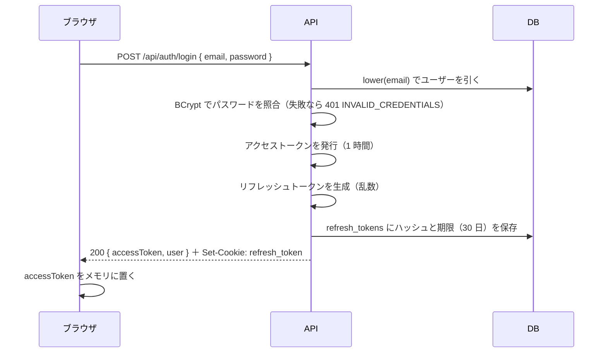
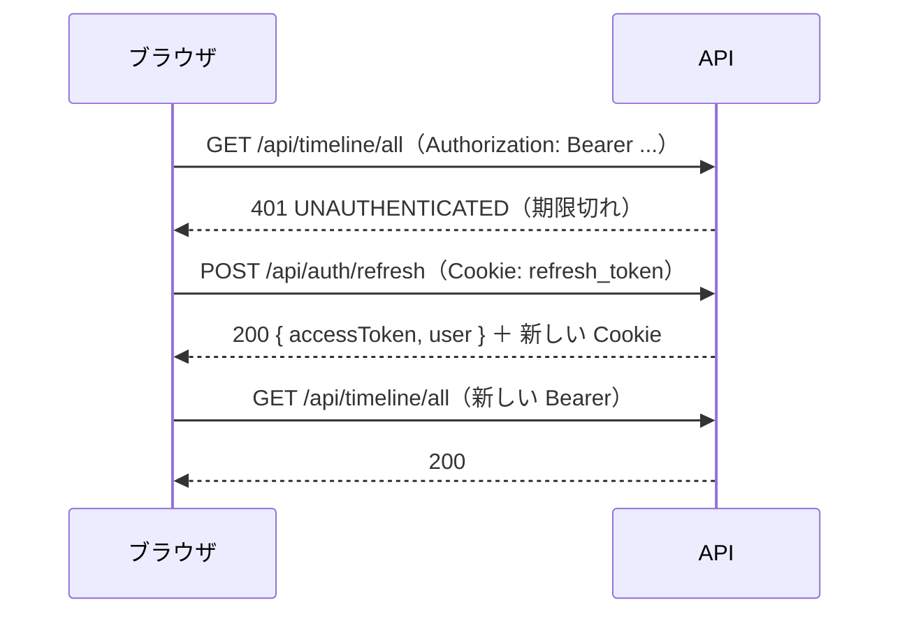
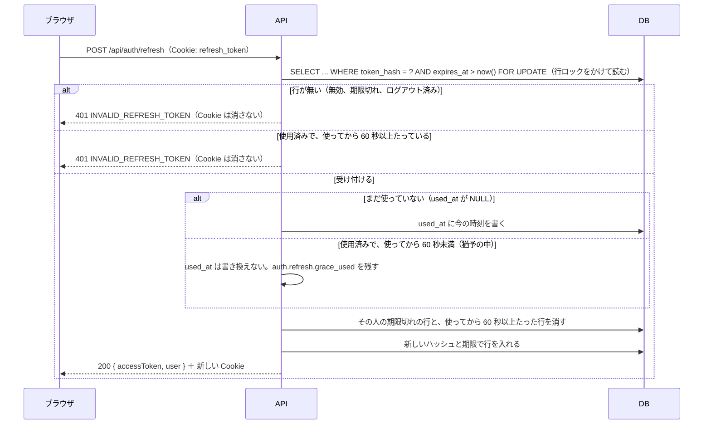
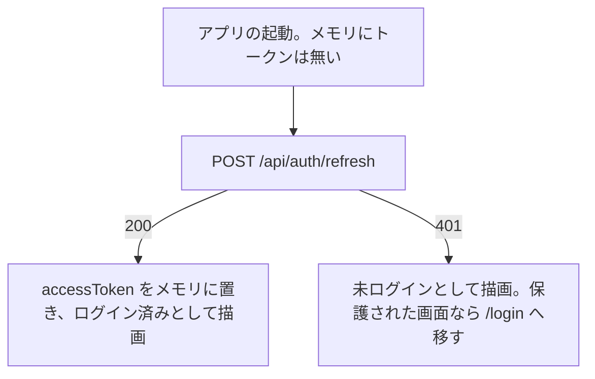

# 認証認可設計

- 日付: 2026-10-06

## 1. 方針

- 認証は JWT による。**有効期限 1 時間のアクセストークン**と、**有効期限 30 日のリフレッシュトークン**を併用する
- アクセストークンは JS のメモリにだけ置き、API 呼び出しの `Authorization: Bearer` ヘッダーで送る
- リフレッシュトークンは httpOnly Cookie に置き、`/api/auth` 配下の API にだけ送られる（使うのは更新とログアウト）。サーバーはハッシュを DB に持ち、ログアウトで無効にできる
- サーバーはセッションを持たない（ステートレス）。EC2 を増やしても設計は変わらない
- すべての画面と API はログインが要る。例外は登録・ログイン・更新・ログアウト・ヘルスチェックだけ

## 2. トークンの仕様

| | アクセストークン | リフレッシュトークン |
| --- | --- | --- |
| 形式 | JWT（HS256 で署名） | 256 ビットの乱数を Base64URL にした文字列。JWT ではない |
| 中身 | `sub`（ユーザー id）、`iat`、`exp`、`iss`（`raise-timeline`） | 意味のある中身は無い |
| 有効期限 | 発行から 1 時間 | 発行から 30 日 |
| 置き場所 | ブラウザの JS のメモリ | httpOnly Cookie |
| 送り方 | `Authorization: Bearer <token>` | ブラウザが Cookie として自動で送る |
| サーバー側の保存 | しない。署名を検証するだけ | `refresh_tokens` に SHA-256 のハッシュを保存する。トークンそのものは保存しない |
| 無効化 | できない（1 時間で切れる） | 行を消せば即座に無効 |
| 使うたび | 変わらない | 新しいものに差し替える（ローテーション）。使った古いものは、使った時刻を書いて 60 秒だけ受け付け（猶予。3 章）、そのあと消す |

Cookie の属性は次のとおり。

```
Set-Cookie: refresh_token=<token>; HttpOnly; Secure; SameSite=Lax; Path=/api/auth; Max-Age=2592000
```

- `HttpOnly`: JS から読めない。XSS で盗めない
- `Secure`: HTTPS でしか送らない。既定で付ける（設定値 `auth.cookie-secure` の既定は true）。ローカルだけ `docker-compose.yml` が `AUTH_COOKIE_SECURE=false` を渡して外す。Safari は `http://localhost` で `Secure` の Cookie を受け付けないという報告があるため。ローカルで実際に確かめる
- `SameSite=Lax`: 他のサイトからの POST には付かない。更新とログアウトを他サイトから呼ばせない
- `Path=/api/auth`: `/api/auth` 配下（登録・ログイン・更新・ログアウト）にしか送られない。他の API に毎回付いて回らない

署名鍵（`JWT_SECRET`）は 256 ビット以上の乱数で、環境変数から読む。鍵を変えると発行済みのアクセストークンはすべて無効になる（最長 1 時間で復帰する）。

## 3. 流れ

### 登録とログイン



登録（`POST /api/auth/register`）は、ユーザーを作ったあと同じ手順でトークンを返す。登録した瞬間からログイン済みになる。

### API の呼び出しと、期限切れのときの更新



- 更新を試すのは 401 `UNAUTHENTICATED` のときだけ。ログイン失敗の 401 `INVALID_CREDENTIALS` では試さない
- 401 のときに更新を試すのは **1 回だけ**。更新も 401 なら、ログアウト状態にしてログイン画面へ移す
- 更新の要求は、同じタブの中では 1 本にまとめる（進行中の更新があればそれを待つ）。起動時の更新も API クライアントの更新も、同じ関数を通す。開発中は React の StrictMode で effect が 2 回走るので、まとめていないと起動のたびに 2 本出る
- タブの間では Web Locks API（`navigator.locks.request('auth-refresh', ...)`）で順番に並べる。ブラウザの再起動でタブが復元されたときや、複数のタブを同時にリロードしたときに、同じ Cookie で更新が 2 本出ても、サーバーの猶予（下の「更新の猶予」）で両方成功するが、そのたびにリフレッシュトークンが 1 つ増え、猶予の出来事も残るため。1 本ずつ並べれば、後のタブは前のタブが受け取った新しい Cookie で成功し、猶予に頼らずに済む

### 更新（サーバー側）



行ロックをかけて読むのは、同時に 2 本の更新が来ても、後の 1 本が前の 1 本のコミットを待ってから読むようにするため。ロックが無いと、まだ使っていないトークンが同時に 2 本来たとき、2 本とも「まだ使っていない」と読み、使った時刻を 2 回書いて後のほうで上書きしてしまい、猶予の出来事も残らない。ロックがあれば、後の 1 本は `used_at` が書かれた行を読み、猶予の扱いになる。両方とも成功するので、有効なトークンが 2 本できる。どちらも有効なので、ブラウザの Cookie がどちらになってもログインは続く。401 のときに Cookie を消さないのは、同時に出たもう 1 本が受け取った新しい Cookie を、遅れて届いた 401 の応答で消してしまわないため。無効な Cookie は期限が来れば消える。

### 更新の猶予

リフレッシュトークンは使うたびに新しいものへ差し替える。ところが、サーバーが差し替えたのに新しい Cookie がブラウザに届かないことがある。古いトークンの行をすぐ消すと、ブラウザには消えた古いトークンしか残らず、次の更新が 401 になってログアウトする。起きうる経路は 3 つ。

1. 更新の応答が届く前に、ページを読み直した
2. ページの全読み込みを、ごく短い間隔で 2 回続けた（同じ Cookie の更新が 2 本重なる）
3. 画面が待ち時間の上限（30 秒）で更新を打ち切ったが、サーバーは完了させていた

新しいトークンは届かなかった応答の中にしかなく、画面からは取り戻せない。そこで、更新に使ったトークンの行を消さず、使った時刻（`used_at`）を書いて残す。**使ってから 60 秒未満に同じトークンが来たら、受け付ける。** 受け付けたときも、別の新しいトークンを発行する。最初の更新で発行したトークンは、DB にハッシュしか無いので返し直せない。

- **60 秒の理由。** 10 秒では、遅い回線の経路 1 と経路 3 がほぼ直らない。30 秒では、経路 3 は、サーバーの処理が打ち切りの直前だったときしか直らない。60 秒にしても、上乗せは本人の更新の間隔（およそ 1 時間）に比べて小さい。設定値は `auth.refresh-token-grace`（8 章）
- **数え方。** 最初に使った時刻から数える。猶予の中で使われても `used_at` は書き換えない。書き換えると、60 秒ごとに使えば古いトークンをいつまでも生かせる。使ってから 60 秒ちょうどで 401 になる
- **弱くなる幅。** 盗んだ人が古いトークンを使える時間が、本人の更新から 60 秒だけ延びる。盗んだ人は、本人の次の更新までなら、もともといつでも使えた。アクセストークンが 1 時間で切れるので、使っている人ならおよそ 1 時間ごとに更新が来る。それに比べて 60 秒の上乗せは小さい。猶予の中で何度使っても、最初に使った時刻から 60 秒で締まる
- **ログアウト。** 送られたトークンの行だけを消す。直前に使った古いトークンは、猶予の残り（最長 60 秒）は受け付けたままになる。ただし、そのとき Cookie は消えるので、古いトークンを持つのは盗んだ人だけで、その人は本人の更新より前ならいつでも使えた。ログアウトで猶予の中の行まで消すと、別の端末が猶予で立ち直る途中だった場合に、その端末をログアウトさせてしまう
- **猶予を過ぎたあと。** 猶予は、打ち切りからではなく、サーバーが使った時刻から数える。経路 3 では、打ち切りのあとにやり直せる時間は 60 秒より短い（送ってすぐサーバーが使っていれば、30 秒ほど）。過ぎてからは今までどおり 401 になり、ログアウトになる
- **届かなかったトークン。** 誰も持たないまま、発行から 30 日で期限が切れる。猶予が無くても経路 3 で同じことは起きていたので、新しい危険ではない
- **掃除。** 更新のついでに、その人の期限切れの行と、使ってから 60 秒以上たった行を消す。いま使った行は猶予の中なので消えない
- **出来事。** 猶予の中で受け付けたら、出来事 `auth.refresh.grace_used` を残す。初めて使った成功は出来事にしない。通知は付けず、本番で数を見てから決める（[logging-design.md](logging-design.md) の 3 章）
- **既にある行。** `used_at` は NULL（まだ使っていない）になる。マイグレーションを当てた時点でログイン中の人は、ログアウトされない

### 画面の起動時



リロード・URL の直接入力・タブの開き直しのたびに、この 1 往復が入る。画面内の移動（React Router）ではメモリが保たれるので入らない。
往復の間は読み込み中の表示を出す。

### ログアウト

（退会の流れは [features/auth.md](features/auth.md) の 4 章。パスワードを照合し、`users` の行を消し、Cookie を消す）

1. 画面で確認ダイアログを出す
2. `POST /api/auth/logout`（Cookie）。サーバーは該当の `refresh_tokens` の行を消し、Cookie を消す応答を返す
3. 画面はメモリのアクセストークンと利用者の情報を捨て、TanStack Query のキャッシュを消して、`/login` へ移す
4. 同じブラウザの他のタブへ「ログアウトした」と知らせる（下の「他のタブへの知らせ」）

アクセストークンは残り最長 1 時間有効だが、ブラウザから捨てているので使われない。

### 他のタブへの知らせ（1 つのブラウザで 1 人）

リフレッシュトークンの Cookie は同じブラウザの全タブで共有されるが、アクセストークンはタブごとのメモリにある。知らせないと、共用の端末でタブ A がログアウトしても、閉じ忘れたタブ B は持っているトークンで最長 1 時間は動き、次の人が前の人として投稿できてしまう。タブ A でログアウトして Y がログインすると、タブ B の次の更新は Y のトークンを返し、画面は X のまま、操作だけ Y になる。この食い違いを 2 段で塞ぐ。

1. **知らせる。** ログイン・登録・ログアウトの後に、`BroadcastChannel`（チャンネル名 `raise-timeline-auth`）で `{ type: 'auth-changed' }` を送る。受け取ったタブは、アクセストークン・利用者・TanStack Query のキャッシュを捨て、起動時と同じ流れ（`POST /api/auth/refresh`）で取り直す。取り直しの間は読み込み中の表示を出し、書きかけの入力は消える。Cookie はもう新しい状態なので、取り直した結果は最後にログインした人（ログアウトなら未ログイン）になる
2. **受け損ねたときの安全網。** 更新で返った利用者が、そのタブが覚えている利用者と違えば、新しいトークンは使わず、期限切れと同じ扱いで未ログインにする（7 章の「別の利用者が返ったとき」）

結果として、**1 つのブラウザでログインしているのは、最後にログインした 1 人だけ**になる。別のユーザーで同時に使いたいときは、ブラウザのプロファイルかシークレットウィンドウを分ける。採らなかった案は 9 章。

## 4. パスワード

- 保存は BCrypt（Spring Security の `BCryptPasswordEncoder`、強度は既定の 10）
- 入力は 8〜72 文字の、空白を含まない ASCII の印字可能文字（0x21〜0x7E）。BCrypt が 72 バイトまでしか見ないため、バイト数と文字数が一致する範囲に限る
- ログイン失敗の応答は「メールアドレスまたはパスワードが違います」の 1 種類。メールアドレスの有無を教えない
- ログイン・登録・退会（`DELETE /api/users/me`）は nginx で 1 IP あたり毎分 20 回（バースト 20）に制限する（本番のみ。ローカルの Vite には無い。[architecture.md](architecture.md)）
- パスワードはログに出さない。要求本文はログに書かない（[logging-design.md](logging-design.md) の 5 章）
- ログインで該当するメールアドレスが無いときも、ダミーのハッシュと照合してから 401 を返す。照合を飛ばすと応答時間の差でメールアドレスの有無が分かる
- 登録の 409 `EMAIL_TAKEN` で、そのメールアドレスが登録済みかは分かる。メール確認を入れない以上これは避けられないので、受け入れる
- ログインの成功と失敗、投稿とコメントの削除、退会は、出来事として残す。残す値とレベルは [logging-design.md](logging-design.md) の 3 章が正本

## 5. 公開 API と認可の規則

### 認証なしで呼べる API

| API | 理由 |
| --- | --- |
| `POST /api/auth/register` | 登録 |
| `POST /api/auth/login` | ログイン |
| `POST /api/auth/refresh` | Cookie で認証する |
| `POST /api/auth/logout` | Cookie で特定する。トークンが無くても 204 |
| `GET /api/health` | ALB のヘルスチェック |

それ以外の `/api/**` はすべて有効なアクセストークンが要る。無ければ 401 `UNAUTHENTICATED`。

### 認可の規則

| 操作 | 許す人 | それ以外 |
| --- | --- | --- |
| 投稿の編集・削除 | 投稿した本人 | 403 |
| コメントの削除 | 書いた本人 | 403 |
| プロフィールの更新、アイコンの更新 | 本人（`/api/users/me` なので他人を指定できない） | — |
| いいね・フォローの付け外し | 自分として行う操作のみ（URL に相手を指定し、主体はトークンの利用者） | — |
| 退会 | 本人（`/api/users/me`）。パスワードの再入力が要る | — |
| 閲覧（タイムライン、プロフィール、一覧、検索） | ログイン済みなら誰でも | 401 |

判定は、サービス層で「資源の持ち主の id」と「トークンの `sub`」を比べて行う。存在しない資源は 404、存在するが他人のものは 403。
役割（管理者など）は無い。全員が同じ権限を持つ。

## 6. バックエンドの構成（Spring Security）

| 項目 | 内容 |
| --- | --- |
| セッション | `STATELESS`。`JSESSIONID` を発行しない |
| JWT の検証 | `spring-boot-starter-security-oauth2-resource-server`（Spring Boot 4 で `spring-boot-starter-oauth2-resource-server` から改名された）の `NimbusJwtDecoder.withSecretKey(key).macAlgorithm(MacAlgorithm.HS256)` を使う。`iss` の検証は既定では行われないので、`JwtValidators.createDefaultWithValidators(...)` に、`Clock` を設定した `JwtTimestampValidator`（期限。テストで時刻を固定するため）と `JwtIssuerValidator("raise-timeline")` を渡して設定する。この関数は渡した検証と同じ型の既定の検証を重ねないので `Clock` つきの期限検証が残り、既定の `typ`（`JwtTypeValidator`）と thumbprint の検証も加わる。`Authorization: Bearer` を自動で読み、`sub` を認証情報にする |
| JWT の発行 | 同じ依存に含まれる `NimbusJwtEncoder`。鍵は `ImmutableSecret` で渡す。既定は RS256 なので、発行時に `JwsHeader.with(MacAlgorithm.HS256)` を指定する。追加の JWT ライブラリは入れない |
| Bearer を読まない範囲 | `/api/auth/` で始まるパスでは `Authorization: Bearer` を読まない（`BearerTokenResolver` を差し替える）。この配下は Cookie か本文で認証する口なので、期限切れのアクセストークンがヘッダーに付いたままでも、先に検証されて 401 にならず、更新とログアウトが動く。画面も Bearer を付けないが、サーバー側でも守る |
| `/api/auth/**` に置けないもの | 認証が要るエンドポイントを `/api/auth/**` の下に置かない。この配下は Bearer を読まないので、`@AuthenticationPrincipal` が null になる |
| 401 と 403 の応答 | `AuthenticationEntryPoint` と `AccessDeniedHandler` を差し替え、Problem Details の形で返す（[error-handling-design.md](error-handling-design.md)） |
| CSRF 対策 | Spring Security の CSRF トークンは無効にする。状態を変える API は Bearer ヘッダーで認証し、Cookie だけで動くのは更新とログアウトのみ。その 2 つは `SameSite=Lax` で他サイトからの POST を防ぎ、応答（アクセストークン）も他サイトからは読めない |
| パスワード | `BCryptPasswordEncoder` |
| リフレッシュトークンの生成 | `SecureRandom` で 32 バイト → Base64URL。保存は SHA-256 の 16 進文字列。更新は行ロック（`SELECT ... FOR UPDATE`）で読み、使った時刻を書く（3 章） |
| 期限切れの掃除 | 更新時に、その利用者の期限切れの行と、使ってから猶予（60 秒）以上たった行をついでに消す。定期の掃除は入れない |
| ログイン中の利用者 | コントローラは `@AuthenticationPrincipal` で `sub` を受け取る。サービス層には利用者 id を引数で渡す |
| テスト | `spring-boot-starter-security-test`（`@WithMockUser` と `jwt()` の RequestPostProcessor）を test の依存に足す |
| 同時の登録 | 同じユーザー名やメールアドレスが同時に来たら、一意制約の違反を制約名で見分けて 409 に変換する |
| 退会した利用者のトークン | アクセストークンは退会後も最長 1 時間は署名が有効なので、認証のたびに `users` に利用者が存在するかを主キーで確かめ、無ければ 401 `UNAUTHENTICATED` にする（`OAuth2TokenValidator<Jwt>`（`UserExistsValidator`）で `sub` の存在を見る）。1 要求につき主キーの検索が 1 回増えるが、この規模では問題にしない。次の 3 点を決めている。(1) 存在確認は、`createDefaultWithValidators` の既定の検証（署名・期限・発行者）がすべて通ったときだけ走らせ、失敗があればその結果をそのまま返す。`DelegatingOAuth2TokenValidator` は全部の検証を回すので、検証をそのまま並べると、期限切れや発行者違いのトークンでも DB に問い合わせてしまう。(2) 存在確認で DB が例外を投げたら、401 に変えず 500 にする（`RequestLogFilter` が `INTERNAL_ERROR` にする）。401 にすると、画面は更新を試み、それも失敗してログアウトさせるので、DB の障害で全員がログアウトされてしまう。(3) `sub` が UUID として読めないトークンは、DB に問い合わせずに `invalid_token` で失敗させる。署名が正しい以上まず起きないが、`sub` を読む処理の例外を 500 にしないため |

## 7. フロントの認証状態

| 項目 | 内容 |
| --- | --- |
| 状態の置き場 | React の Context（`AuthProvider`）が `status`（`loading` / `authenticated` / `anonymous`）、`user`、`signedOut`（自分でログアウトしたか）を持つ。アクセストークンは Context に入れず、`frontend/src/auth/tokenStore.ts` のモジュール変数に置く（API クライアントが画面の再描画と無関係に読むため） |
| 起動時 | `AuthProvider` が、API クライアントと同じ「更新を 1 本にまとめる関数」で `POST /api/auth/refresh` を 1 回呼ぶ。終わるまで `loading` |
| 保護された画面 | `status` が `anonymous` なら（自分でログアウトした直後を除き）`/login?next=<元のパス>` へ移す。ログイン後に `next` へ戻す。`next` は `/` で始まり、`//` と `/\` で始まらず、制御文字（タブ・改行）を含まない値だけを受け付ける（外部サイトへ飛ばされないため。ブラウザは URL のタブと改行を取り除くので、`/<タブ>/evil.example` は `//evil.example` になる）。それ以外は `/` へ |
| ログイン済みで `/login` `/register` | `next` があれば（`safeNext` を通して）そこへ、無ければ `/` へ移す。ログイン後・登録後の移動もこの仕組みが担う。ログイン画面は状態を更新するだけで自分では移動しない（両方が移動すると、後から走るほうが前の移動を上書きして `next` に戻れなくなるため） |
| API クライアント | `fetch` を包む 1 つの関数。Bearer を付ける。ただし認証の 4 つの API（登録・ログイン・更新・ログアウト）には Bearer を付けず、401 でも更新してやり直さない（本文か Cookie で認証する口なので、二重の守りにしている。サーバーはこの配下で Bearer を読まず（6 章）、画面も付けない）。401 `UNAUTHENTICATED` なら更新を 1 回試してやり直す。更新は同じタブでは 1 本だけ（進行中の Promise を共有する。共有は同じ世代の間に限る。世代が進んだ後の呼び出しが古い世代の更新に相乗りすると、捨てられた結果（null）を受け取り、新しい世代で要る更新が行われないため）、タブの間では Web Locks API で順番に並べる |
| ログアウト | API を呼んでから状態を捨て、TanStack Query のキャッシュも消し（他人のデータを残さない）、他のタブへ知らせる。自分でログアウトしたあとは `next` を付けずに `/login` へ移す（付けると、次にログインした人が前の人の画面に着くため）。セッションの期限切れや、URL の直接入力・リロードで未ログインと分かったときは `/login?next=…` へ移す |
| 期限切れでキャッシュを消す | 更新が 401 で終わって未ログインになったとき、TanStack Query のキャッシュを消す。残すと、次にログインした人に前の人の一覧が見える。ログアウトで消すのと同じ理由 |
| Cookie を書き換える 3 つの API | 登録・ログイン・ログアウトは、更新と同じ鍵 `auth-refresh`（Web Locks）の中で送る。更新の応答が遅れて届くと、その後に済んだログインやログアウトの Cookie を古い値に戻す競合があったため。鍵の中で送る要求は Bearer なしで 401 でも更新しないものだけにする。Web Locks は再入できないので、鍵の中で更新（`refreshSession`）を呼ぶと、自分が持つ鍵を待って止まる。 |
| タブの間の同期 | ログイン・登録・ログアウトの後に `BroadcastChannel`（`raise-timeline-auth`）で `{ type: 'auth-changed' }` を送る。受け取ったタブは世代を進め、トークン・利用者・キャッシュを捨てて `loading` にし、起動時と同じ更新で取り直す。結果は、始めたときから世代が変わらず、かつ `loading` のときだけ反映する（取り直しが重なっても、後の結果だけが残る）。チャンネルは購読が 0 になったら閉じる。購読が 1 つも無いときの送信は、一時的なチャンネルで送ってすぐ閉じる。送れなくても、その端末の操作は成功させる |
| 別の利用者が返ったとき | API クライアントは要求を送る前に、セッションの世代とこのタブの利用者 id を控える。401 `UNAUTHENTICATED` を受けたとき、控えた利用者 id が無い（このタブは未ログイン）か、世代が変わっていれば（送ったあとにログイン・ログアウト・他のタブの知らせでの取り直し・利用者の食い違いがあった）、更新もやり直しもせず 401 のまま失敗させる。更新から戻ったあとも、世代が同じで、返った利用者が控えた利用者と同じときだけやり直す。更新で返った利用者がタブの覚えている利用者と違えば、新しいトークンは置かずに期限切れと同じ扱い（未ログイン、キャッシュを消す）にし、世代も進める。進めないと、飛んでいる最中の前の利用者の要求が新しく更新を始め、別の人のトークンでやり直されてしまう。起動時のように、まだ覚えていないときは見比べる相手が無いので、そのまま受け入れる |
| 描画の例外 | `ErrorBoundary` が受け止め、「問題が起きました。再読み込みしてください」の画面を出す |

## 8. 設定値

| 設定 | 値 | 置き場 |
| --- | --- | --- |
| `JWT_SECRET` | 256 ビット以上の乱数（Base64） | ローカルは `docker-compose.yml` のローカル専用の値（`.env` で上書きできる）、本番は SSM Parameter Store |
| アクセストークンの有効期限 | 1 時間 | `application.properties` |
| リフレッシュトークンの有効期限 | 30 日 | `application.properties` |
| `auth.refresh-token-grace` | 60 秒（`PT60S`）。使ったリフレッシュトークンをこの間だけ受け付ける。0 は猶予なし。未設定か負の値なら、起動を止める | `application.properties` |
| Cookie 名 | `refresh_token` | `application.properties` |
| `auth.cookie-secure` | 既定 true。ローカルは compose が false を渡す | `application.properties`（ローカルは `docker-compose.yml` の環境変数） |

## 9. 採らなかった案

| 案 | 採らなかった理由 |
| --- | --- |
| アクセストークンだけ（有効期限 7 日、localStorage） | 実装は少ないが、サーバー側でログアウトできず、盗まれると 7 日間使われる |
| アクセストークンを localStorage に置く | 起動時の 1 往復が要らなくなるが、XSS でトークンを読み出して持ち去られる。メモリでも、XSS が起きればその場で更新 API を呼んでアクセストークンを得られるので無傷ではないが、持ち去れないのはリフレッシュトークンで、被害は最長 1 時間に限られる |
| アクセストークンも httpOnly Cookie に置く | 全 API が Cookie 認証になり、CSRF 対策が全面的に要る。JWT を Bearer で送る形を学ぶ目的にも合わない |
| JWT ライブラリ（jjwt など）を足す | Spring Security の標準部品で発行も検証もできる。依存を増やさない |
| リフレッシュトークンの再利用検知（猶予を過ぎた使用済みのトークンが来たら、その人の全トークンを消す） | 守りは強くなるが、使った行を 30 日残す必要がある。しかも、届かなかった応答のあとで 60 秒を過ぎてやり直すと、盗まれていなくても全端末がログアウトする。ログアウトさせないという猶予の目的と逆向きになる。将来の課題にする（10 章） |
| リフレッシュトークンの使い捨てをやめる（ログインからログアウトまで同じトークン） | 重なりは根本から消えるが、盗まれたトークンが本人の更新で使えなくなる守りを丸ごと手放す |
| 画面だけで、更新が 401 になったあと少し待って 1 回やり直す | 直るのは、もう 1 本の応答が新しい Cookie を届けていた場合（上の経路 2 の一部）だけ。経路 1 と 3 は新しい Cookie が届いていないので直らない |
| 猶予を 10 秒や 30 秒にする | 10 秒は、遅い回線の経路 1 と経路 3 がほぼ直らない。30 秒は、経路 3 がサーバーの処理が打ち切りの直前だったときしか直らない。60 秒にしても、上乗せは本人の更新の間隔（およそ 1 時間）に比べて小さい |
| ログアウトで、その人の猶予の中の行も消す | 猶予の中のトークンを持つのは盗んだ人だけで、その人は本人の更新より前ならいつでも使えた。消すと、別の端末が猶予で立ち直る途中だった場合に、その端末をログアウトさせる |
| 猶予の中で使ったら、使った時刻を書き換える | 60 秒ごとに使えば、古いトークンをいつまでも生かせる |
| 古い行の `expires_at` を「今＋60 秒」に縮める（列を足さない） | DB の変更は要らないが、使用済みかどうかが分からなくなり、猶予の出来事を残せず、再利用検知の土台にもならない。`expires_at` の意味（発行から 30 日）も変わる |
| サーバーでアクセストークンを無効にする（ログアウトで他のタブのトークンを止める） | 失効の一覧をサーバーに持つか、トークンに版を持たせて毎回照合することになり、「アクセストークンは署名を検証するだけ」（2 章）のステートレスな設計を大きく変える。しかも食い違いは、別の利用者のトークンが正しく発行された有効なものとして返ってくることで起きるので、無効化しても直せない |
| 他のタブへの知らせを localStorage の変化（`storage` イベント）で行う | `BroadcastChannel` で足りる。変化を知らせるために localStorage へ値を書くと、トークンに近い値を永続領域に置く理由が増え、メモリにだけ置く方針（この表の 2 行目）から外れていく |
| タブに戻るたびに、いまの利用者を確かめる | 確かめるまでの間が残る（戻る前の操作は前の人のまま通る）。前面に戻るたびに通信も出る。知らせる方式なら、その間が無い |

## 10. 将来の課題

- リフレッシュトークンの再利用検知（猶予を過ぎた使用済みのトークンが来たときの扱い。更新に使った時刻の列 `used_at` が土台になる）
- パスワードの変更・再設定（メール送信の仕組みが要る）
- メール確認
